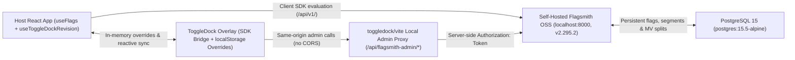

# ToggleDock

**A drop-in React devtools overlay and 2-command local stack for self-hosted open-source Flagsmith.**

[](https://github.com/NottieCat/toggle-wars)
[](https://github.com/Flagsmith/flagsmith)
[](./LICENSE)

---

## The Problem

> *"The thing you wish existed when self-hosting Flagsmith."*

Running open-source Flagsmith locally is powerful, yet day-to-day frontend development against it still feels like juggling browser tabs:

1. **Cold-start boilerplate:** Spinning up Docker containers still leaves you clicking through registration, organisation setup, environments, flags, multivariate allocations, and segments before writing a single line of app code.
2. **Tab-switching tax:** Checking how your UI behaves across boolean gates, multivariate variants, or identity segments means bouncing back and forth between your app and `http://localhost:8000` — or mutating shared Dev flags just to test a local edge case.
3. **Silent environment drift:** Development and Production feature states diverge quietly over weeks until someone discovers a missing flag, wrong string token, or zeroed multivariate split at 2 AM.

**ToggleDock** eliminates all three. One `npm run setup` command boots and seeds a real self-hosted Flagsmith + PostgreSQL stack, and one `<ToggleDock />` component gives your React app a `⌘⇧F` (`Ctrl+Shift+F`) in-app control plane for local overrides, multivariate previews, live segment spoofing, environment drift diffing, and one-click server persistence.

---

## Architecture

ToggleDock wraps the active `flagsmith` JavaScript SDK instance in memory for zero-latency local overrides while routing privileged Admin API reads and writes through a zero-CORS `toggledock/vite` dev-server proxy so `FLAGSMITH_ADMIN_TOKEN` never touches the browser bundle.



---

## 2-Command Quickstart

### Prerequisites

- **Docker Desktop** (running locally)
- **Node.js `>= 20.0.0`**

### Boot Everything in Two Commands

```bash
git clone https://github.com/NottieCat/toggle-wars.git
cd toggle-wars

# 1. Start Flagsmith OSS + Postgres, run migrations, seed flags/segments, write .env.local, build package
npm run setup

# 2. Launch the Meridian Cloud demo workbench with ToggleDock attached
npm run dev
```

What `npm run setup` (`scripts/setup.mjs`) automates for you:
1. Verifies the Docker daemon is running (`docker info`).
2. Installs workspace dependencies automatically if `node_modules` is missing (pass `--install` to force reinstall).
3. Starts `postgres:15.5-alpine`, runs `migrate-db`, and boots `docker.flagsmith.com/flagsmith/flagsmith:latest` (`v2.295.2`) on port `8000`.
4. Polls `http://localhost:8000/health` and `/api/v1/` until every backend check reports `working` (`scripts/wait-for-flagsmith.mjs`).
5. Idempotently seeds the `ToggleDock Demo` organisation, `SaaS Playground` project, `Development` & `Production` environments, 5 drifted flags, and the `beta_testers` segment override, then writes gitignored `apps/demo/.env.local` (`scripts/bootstrap.mjs`).
6. Compiles the reusable `toggledock` library (`packages/toggledock`).

### Local URLs & Credentials

| Surface | URL / Value | Notes |
| :--- | :--- | :--- |
| **Meridian Cloud Demo App** | `http://localhost:5173` | Edge compute & telemetry workbench — press **`⌘⇧F`** (macOS) or **`Ctrl+Shift+F`** (Windows/Linux) to toggle ToggleDock |
| **Self-Hosted Flagsmith Dashboard** | `http://localhost:8000` | Real open-source Flagsmith console backed by PostgreSQL 15 |
| **Admin Email** | `dev@toggledock.local` | Override via `FLAGSMITH_ADMIN_EMAIL` |
| **Admin Password** | `FlagPass123!` | Override via `FLAGSMITH_ADMIN_PASSWORD` (see note below) |

> **Why `FlagPass123!`?** Flagsmith `v2.295.2` enforces Django's `UserAttributeSimilarityValidator` on `POST /api/v1/auth/users/`, rejecting passwords containing `ToggleDock` against `dev@toggledock.local`. Both email and password are configurable via `FLAGSMITH_ADMIN_EMAIL` and `FLAGSMITH_ADMIN_PASSWORD`.

### Teardown & Workspace Commands

| Command | Description |
| :--- | :--- |
| `npm run setup` | Full one-command bootstrap (Docker + migrations + Flagsmith seed + library build) |
| `npm run dev` | Build `toggledock` and start Meridian Cloud at `http://localhost:5173` |
| `npm run down` | Stop Flagsmith + PostgreSQL containers (preserves `pgdata` volume) |
| `npm run flagsmith:reset` | Stop containers and remove `pgdata` volume for a clean slate |
| `npm run bootstrap` | Re-run the idempotent seeder (restores all 5 flags & segment overrides in ~1s) |
| `npm run build` | Build both `packages/toggledock` (`tsup`) and `apps/demo` (`vite build`) |
| `npm run typecheck` | Run `tsc --noEmit` across both workspaces |
| `npm run test` | Run the `toggledock` unit test suite (`vitest run`) |

---

## Drop `<ToggleDock />` into Any React App in 5 Lines

`toggledock` ships as a standalone, dual ESM/CJS TypeScript package (`packages/toggledock`) with self-contained scoped styles (zero Tailwind or CSS framework dependency in your host app) and a companion `toggledock/vite` proxy plugin.

### 1. Mount `<ToggleDock />` in React (5 lines)

```tsx
import { useFlagsmith } from 'flagsmith/react';
import { ToggleDock } from 'toggledock';

export function DevOverlay() {
  const flagsmith = useFlagsmith();
  return (
    <ToggleDock
      flagsmith={flagsmith}
      projectId={import.meta.env.VITE_FLAGSMITH_PROJECT_ID}
      devEnvKey={import.meta.env.VITE_FLAGSMITH_DEV_ENV_KEY}
      prodEnvKey={import.meta.env.VITE_FLAGSMITH_PROD_ENV_KEY}
    />
  );
}
```

> **Tip for `flagsmith@10.0.0` consumers:** Standard `useFlags()` works out of the box, and `toggledock` also exports `useToggleDockRevision(flagsmith)` and `useToggleDockFlags(keys, flagsmith)` (powered by `useSyncExternalStore`) so host components stay 100% reactive across unlimited consecutive local toggles and identity switches.

### 2. Add the 1-Line Zero-CORS Vite Admin Proxy

```ts
// vite.config.ts
import { defineConfig } from 'vite';
import react from '@vitejs/plugin-react';
import { flagsmithAdminProxyPlugin } from 'toggledock/vite';

export default defineConfig({
  plugins: [react(), flagsmithAdminProxyPlugin()],
});
```

`flagsmithAdminProxyPlugin()` intercepts `/api/flagsmith-admin/*` (plus `/api/flagsmith-admin/__health`) on the Vite dev and preview servers, reads `FLAGSMITH_API_URL`, `FLAGSMITH_ADMIN_TOKEN`, and `FLAGSMITH_ADMIN_AUTH_SCHEME` (`Token`) server-side from `.env.local` or `process.env`, and forwards authenticated requests to `http://localhost:8000/api/v1/` — eliminating CORS errors while keeping your Admin API token strictly out of client bundles.

### Key `<ToggleDock />` Props

| Prop | Type | Default | Purpose |
| :--- | :--- | :--- | :--- |
| `flagsmith` | `FlagsmithLike` | *(required)* | Active Flagsmith JS SDK instance (`useFlagsmith()` or `flagsmith`) |
| `adminProxyUrl` | `string` | `'/api/flagsmith-admin'` | Base path handled by `flagsmithAdminProxyPlugin()` |
| `projectId` | `number \| string` | — | Flagsmith project ID for feature metadata & multivariate options |
| `devEnvKey` | `string` | — | Development environment API key (enables `Sync to Dev` & Drift diff) |
| `devEnvId` | `number \| string` | — | Optional Development environment numeric ID |
| `prodEnvKey` | `string` | — | Production environment API key (enables Drift diff & `Sync Dev → Prod`) |
| `prodEnvId` | `number \| string` | — | Optional Production environment numeric ID |
| `environmentLabel` | `string` | `'Development'` | Label shown in the ToggleDock connection status header |
| `identityPresets` | `IdentityPreset[]` | Built-in presets | Extra persona pills merged alongside `Anonymous`, `Free User`, and `Beta Tester` |
| `valuePresets` | `ValuePresetsMap` | `{ theme_accent: [...] }` | Custom 1-click value pills per flag key |
| `storageKey` | `string` | `'toggledock:overrides:v1'` | `localStorage` persistence key for local overrides |
| `enableShortcut` | `boolean` | `true` | Enables `⌘⇧F` / `Ctrl+Shift+F` toggle and `Esc` close |
| `accentFlagKey` | `string` | `'theme_accent'` | Flag key driving ToggleDock's live accent token (`emerald` \| `amber` \| `indigo`) |
| `defaultOpen` / `defaultTab` | `boolean` / `'flags' \| 'identity' \| 'drift'` | `false` / `'flags'` | Initial drawer visibility and active tab |
| `onFlagsChange` | `(flags, overrides) => void` | — | Callback fired on every local override or server flag refresh |

---

## Core Capabilities

### 1. Live Flags & Instant Local Overrides
- Wraps `flagsmith.hasFeature()`, `flagsmith.getValue()`, and `flagsmith.getAllFlags()` in memory and persists overrides to `localStorage` (`toggledock:overrides:v1`) across reloads.
- Search flags by key, value, or description; inspect `LIVE:` vs `SERVER:` state inline; spot active overrides immediately with amber **`OVERRIDDEN`** badges and header/pill counters.
- Revert any single flag with **`Reset`** or wipe every local override in one click with **`Reset All`** — without modifying server state.

### 2. Push to Self-Hosted Flagsmith Dev (`Sync to Dev`)
- Once a local flag toggle or value looks right, click **`Sync to Dev`** on any row to execute a real `PUT /api/v1/environments/<devEnvKey>/featurestates/<id>/` via `toggledock/vite`.
- Preserves existing multivariate percentage splits automatically, refreshes the live SDK, clears the local override once the server matches, and persists straight to PostgreSQL.

### 3. Multivariate Variant Switcher
- Hydrates real multivariate options and environment-specific traffic weights from `GET /api/v1/projects/<projectId>/features/` and renders 1-click choice pills (`control · 34%`, `annual_first · 33%`, `usage_based · 33%`).
- Also supports custom `valuePresets` pills (such as `emerald`, `amber`, `indigo` for `theme_accent`) and an inline scalar value editor with **`Apply`**.

### 4. Identity & Trait Spoofer
- Calls real `flagsmith.identify(userId, traits)` and `flagsmith.logout()` against your self-hosted Flagsmith engine so server-side segment rules evaluate live.
- Includes 1-click persona presets — **Anonymous**, **Free User** (`free_user_01`: `plan=free`, `beta_tester=false`), and **Beta Tester** (`beta_user_01`: `plan=pro`, `beta_tester=true`) — plus a custom user ID form and typed key/value trait editor (`true`/`false` booleans, numbers, `null`, or strings).

### 5. Environment Drift Diff & Confirmed Promotion (`Dev → Prod`)
- Compares live `Development` and `Production` environment feature states side-by-side in the **Drift** tab, reporting exact drift counts (`DRIFTED` vs `IN SYNC`) and granular drift reasons (`ENABLED`, `VALUE`, `MV SPLIT`).
- Click **`Copy JSON Snapshot`** to copy a structured, timestamped JSON audit report for PRs or incident tickets.
- Promote individual flags (**`Sync Dev → Prod`**) or every drifted flag (**`Sync All Drifted → Prod`**) behind an explicit 2-step confirmation bar (**`Confirm Push to Prod?`**), syncing enabled state, scalar values, and multivariate percentage allocations (preserving target Flagsmith MV row IDs).

---

## How Flagsmith Is Used (Track 3 Criteria)

ToggleDock is built *directly on top of* open-source Flagsmith — removing Flagsmith removes the evaluation engine, multivariate allocator, segment evaluator, and persistent flag store that power every feature:

- **Self-Hosted Open-Source Docker Stack (`docker/docker-compose.yml`):** Runs the official `docker.flagsmith.com/flagsmith/flagsmith:latest` (`v2.295.2`) container alongside `postgres:15.5-alpine` with automated `migrate-db`, `TASK_RUN_METHOD: SEPARATE_THREAD`, `ALLOW_REGISTRATION_WITHOUT_INVITE: 'true'`, and `ENABLE_TELEMETRY: 'false'` — 100% local, zero SaaS dependency.
- **Flagsmith JavaScript & React SDK (`flagsmith@10.0.0`):** `apps/demo/src/main.tsx` mounts `<FlagsmithProvider>` pointed directly at `http://localhost:8000/api/v1/` (`cacheFlags: false`) and consumes flags through `useFlags()` / `useFlagsmith()`. ToggleDock's bridge instruments this live SDK instance without forking it.
- **Multivariate Flags (`pricing_experiment`, `onboarding_flow`):** Both experiments are real Flagsmith `MULTIVARIATE` features seeded with weighted percentage allocations (`34% / 33% / 33%` in Development, `0%` in Production) read from and promoted via Flagsmith's feature and feature-state endpoints.
- **Segments & Traits (`beta_testers`):** `scripts/bootstrap.mjs` creates a real Flagsmith segment matching `beta_tester == "true"` and attaches a Development segment override setting `theme_accent` to `"amber"`. Clicking **Beta Tester** in ToggleDock calls `flagsmith.identify('beta_user_01', { plan: 'pro', beta_tester: true })` and lets Flagsmith itself return `"amber"` over the wire.
- **Flagsmith Management / Admin REST API:** Both `scripts/bootstrap.mjs` and `packages/toggledock/src/core/adminClient.ts` talk directly to Flagsmith's REST API (`/health`, `/auth/users/`, `/auth/login/`, `/organisations/`, `/projects/`, `/environments/`, `/projects/<id>/features/`, `/mv-options/`, `/segments/`, `/create-segment-override/`, and `/environments/<key>/featurestates/<id>/`) using `Authorization: Token <key>` via the server-side `toggledock/vite` proxy.

---

## Seeded Flags & Intentional Dev / Prod Drift

`npm run setup` seeds the **SaaS Playground** project with 5 flags intentionally drifted (`5 / 5 drifted`) between **Development** and **Production**, wired to live UI surfaces in the **Meridian Cloud** demo workbench (`apps/demo`):

| Flag Key | Type | Development State | Production State | Segment Override (Dev) | Drift Reasons | Meridian Cloud UI Surface |
| :--- | :--- | :--- | :--- | :--- | :--- | :--- |
| `promo_banner` | Boolean (`STANDARD`) | **ON** | **OFF** | — | `ENABLED` | Top v4.18 Zero-Cold-Start release announcement strip & collapsible release notes |
| `ai_copilot_widget` | Boolean (`STANDARD`) | **ON** | **OFF** | — | `ENABLED` | Interactive **Meridian Diagnostic Copilot** runbook & live flag-context panel |
| `pricing_experiment` | `MULTIVARIATE` (`control` 34%, `annual_first` 33%, `usage_based` 33%) | **ON** · `"control"` (34/33/33%) | **OFF** · `"control"` (0/0/0%) | — | `ENABLED`, `MV SPLIT` | **Edge Rate Ledger** — switches between monthly comparison matrix, annual-commit featured view, and live metered compute estimator |
| `onboarding_flow` | `MULTIVARIATE` (`wizard` 34%, `direct_dashboard` 33%, `sample_data` 33%) | **ON** · `"wizard"` (34/33/33%) | **ON** · `"direct_dashboard"` (0/0/0%) | — | `VALUE`, `MV SPLIT` | **Edge Workspace Bootstrap** — switches between 3-step checklist, live edge ingress log stream, and synthetic trace load-test percentiles |
| `theme_accent` | String (`STANDARD`) | **ON** · `"emerald"` | **ON** · `"indigo"` | `beta_testers` (`beta_tester == true`) → **`"amber"`** | `VALUE` | Global `--accent` token across Meridian Cloud (`data-accent`) and ToggleDock (`data-td-accent`) |

---

## Monorepo Layout

```text
toggle-wars/
├── docker/
│   └── docker-compose.yml            # Self-hosted Flagsmith OSS (v2.295.2) + Postgres 15.5
├── scripts/
│   ├── setup.mjs                     # One-command orchestrator (`npm run setup`)
│   ├── wait-for-flagsmith.mjs        # Zero-dependency /health + /api/v1/ readiness poller
│   └── bootstrap.mjs                 # Strictly idempotent Flagsmith API seeder + .env.local writer
├── packages/
│   └── toggledock/                   # Reusable MIT-licensed React + Vite library (`toggledock`)
│       └── src/
│           ├── core/                 # overrides.ts, bridge.ts, adminClient.ts, drift.ts, types.ts
│           ├── components/           # ToggleDock.tsx, FlagsTab.tsx, IdentityTab.tsx, DriftTab.tsx
│           ├── styles/               # Self-contained scoped CSS + SSR-safe style injector
│           ├── vite/                 # `toggledock/vite` zero-CORS Admin API middleware plugin
│           └── __tests__/            # Vitest unit tests (overrides, bridge, drift)
├── apps/
│   └── demo/                         # Meridian Cloud — edge compute & telemetry SaaS demo workbench
│       ├── vite.config.ts            # Wires `flagsmithAdminProxyPlugin()` in 1 line
│       └── src/                      # FlagsmithProvider + reactive Meridian Cloud surfaces
├── DEMO_SCRIPT.md                    # Timestamped 2-minute video walkthrough script
├── LICENSE                           # MIT License
└── package.json                      # Root npm workspaces & lifecycle scripts
```

---

## License

Released under the [MIT License](./LICENSE).
